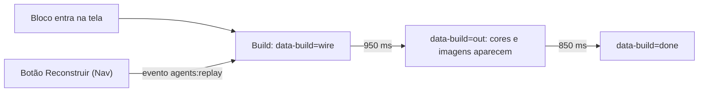
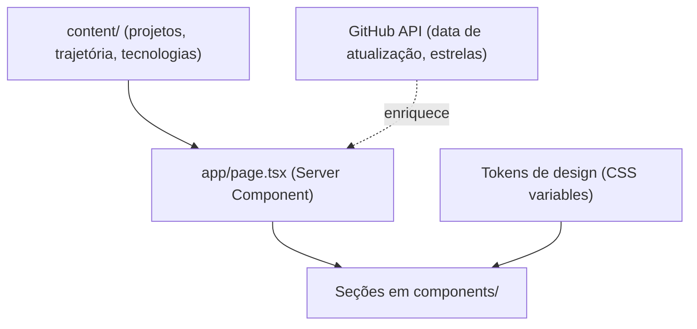

# Design — direção visual e arquitetura

Estado: **redesenho em andamento (2026-11-10, branch `feat/agents-redesign`, não publicado)**; ver a seção "Blueprint e hero com foto" abaixo, que substitui o hero com esfera e o `.scroll-reveal` descritos a seguir. Implementado: tokens de cor, fontes, grade "+", foco visível, `prefers-reduced-motion`, link "pular para o conteúdo" e navegação (etapa 6); hero com palavras gigantes, esfera de cruzes em canvas, rótulos de vidro e cartões de base (etapa 7); Sobre e Trajetória (etapa 8); Projetos como estudos de caso (etapa 9); Tecnologias por evidência, Contato sem formulário e rodapé (etapa 10). SEO e acessibilidade finais (etapa 11): título e descrição a partir de `content/site.ts`, canonical, Open Graph com imagem gerada (`opengraph-image.tsx`), ícones, `sitemap.xml`, `robots.txt`, dados estruturados `Person` (somente informação já pública e com fonte), menu e rodapé fora do `<main>`, links externos com o nome do projeto para leitores de tela. Ainda planejado: README do projeto e revisão final (etapa 12). A entrada ao rolar usa `animation-timeline: view()` (`.scroll-reveal`) onde há suporte.

Regra de entrada de elementos: animações em **CSS** (`.reveal`, `.rise` em `globals.css`), nunca `opacity: 0` vindo de JavaScript no conteúdo principal. O texto precisa estar visível antes da hidratação e sem JS. O que é o maior elemento da tela (LCP) usa só deslocamento (`.rise`).

## Direção visual
Referência de direção artística: shot do Dribbble "AI SaaS Agent Landing — Futuristic Hero" (hero com tipografia gigante atravessada por um objeto central, rótulos de vidro flutuantes, cartões sobrepostos na base e grade de cruzes finas). Usada só como inspiração; não se reproduz objeto, texto nem layout.

**Conceito:** "estrutura sob a superfície". A malha de cruzes "+" é o motivo do site (fundo, marcadores, foco).

| Elemento | Decisão |
|---|---|
| Fundo | Grafite (`#0B0D10`, `#12151A`, `#1A1E25`), gradiente radial frio, luz de borda pontual. Sem neon |
| Acento | Azul-gelo `#8DB4E8`, único |
| Texto | `text-1 #E8EAED`, `text-2 #9AA3AF`, `text-3 #8791A0`. Contraste mínimo 4.6:1 sobre qualquer fundo (o `#5a5a54` antigo dava 2,1 a 2,8) |
| Tipografia | Space Grotesk nos títulos (`font-display`), DM Sans no texto, DM Mono nos metadados, todas via `next/font`. Alternativas avaliadas: Sora e Geist |
| Utilitários | `.plus-grid` (grade de cruzes, só em elemento decorativo com `aria-hidden`), `.glass` (painel de vidro), `.skip-link`, foco `:focus-visible` global |
| Hero | Nome e papel em tipografia gigante, objeto próprio em SVG/canvas leve, etiquetas com fatos verificáveis, cartões de base com borda inclinada |
| Movimento | Entrada escalonada curta e hover discreto; tudo respeita `prefers-reduced-motion` |
| Evitar | Cartões idênticos repetidos, emoji como ícone, estatísticas decorativas, badges, 3D pesado |

## Blueprint e hero com foto (2026-11-10)
Ideia vinda de um vídeo de referência (usada só como direção): cada bloco nasce como wireframe azul e vira conteúdo real. Os cursores "agentes" do vídeo chegaram a ser feitos e foram **removidos** a pedido do Lucas, para a página ficar limpa.

Como ler: `Build` (cliente) só troca um atributo; o wireframe é CSS aplicado ao **layout real** (texto transparente + contorno), então o HTML já sai do servidor com todo o conteúdo.

| Peça | Arquivo | O que faz |
|---|---|---|
| Blueprint | `components/Build.tsx` + `[data-build]` em `globals.css` | Estados wire → out → done; etiqueta com a origem do conteúdo; leve assentamento 3D (rotateX) |
| 3D | `components/Tilt.tsx` | `Tilt`: inclinação pelo mouse nas molduras dos projetos. `Drift`: parallax da foto e da palavra gigante |
| Hero | `components/Hero.tsx` | Foto (`public/lucas.jpg`) como fundo, sem moldura: lado direito no desktop, topo no celular, desbotando no escuro (`.hero-photo`). Palavra gigante só em contorno na base (`.word-outline`). Fica fora do blueprint: texto e foto pintados desde o primeiro quadro |

Movimento extra (pedido do Lucas, sem cursores): barra de progresso de rolagem no topo (`ScrollProgress` em `Tilt.tsx`), faixa de tecnologias rolando abaixo do hero (`components/Marquee.tsx`, CSS puro, pausa no hover), brilho azul que respira atrás do texto do hero (`.hero-glow`) e inclinação 3D nos cartões menores de projeto. Projetos em destaque: Rumo em 1º. Capturas: Rumo (`docs/images/hoje.png` do próprio repositório público, dados de exemplo) e site da Brandão Delícias (rodando localmente, sem dados reais). RIZZEVO Hub e Brandão Gestão seguem sem captura.

Cores (tema mais escuro, tudo em azul): fundo `#05070A`; azul-gelo `#8DB4E8` para blueprint, links e detalhes; azul forte `#4F8CFF` (token `hot`) só no CTA principal e em uma palavra por título. Títulos de seção em caixa alta, peso 700.

Limites conhecidos: o wireframe só vale com JavaScript ativo e sem `prefers-reduced-motion`. Se o JavaScript estiver ativo mas falhar ao carregar, os blocos abaixo do hero ficam em wireframe. O JS da página subiu de 7,7 kB para 59 kB por causa do `motion`; Lighthouse ainda não foi medido de novo. Projetos privados não têm captura de tela (a moldura mostra só o nome).

## Seções
Hero → Sobre → Projetos (estudos de caso) → Tecnologias (por nível de evidência) → Trajetória (só o confirmado) → Contato (links e e-mail, sem formulário).

## Arquitetura de conteúdo

O conteúdo curado em `content/` será a fonte de verdade e decide o que aparece. A API do GitHub (`lib/github.ts`) só complementa e, se falhar, o site continua funcionando. Hoje a lista de projetos vem direto da API, ordenada por estrelas, e isso será substituído.

## Acessibilidade (requisitos)
Teclado completo com foco visível, link "pular para o conteúdo", `lang="pt-BR"`, `aria-hidden` em elementos decorativos, contraste validado, `prefers-reduced-motion`, links externos identificados.
